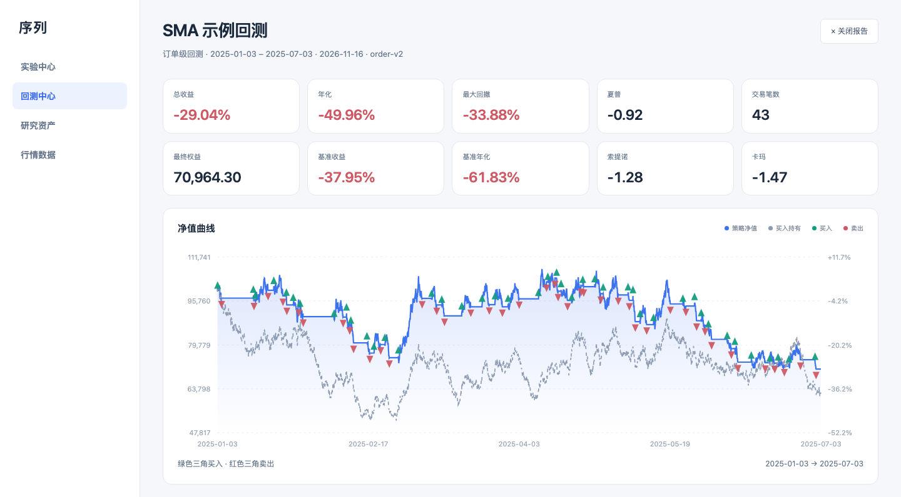

# 序列 · 单标的量化投研平台

在本地用 OKX 永续行情训练模型、验证样本外预测，再通过订单级回测查看研究信号计入交易成本后的表现。



*实际界面截图。示例以合成行情运行 SMA 回测。*

## 项目亮点

- **从行情走到第一份报告。** 查看 OKX USDT 本位永续 K 线，将已入库的区间保存为快照，用 SMA 规则跑一份基线回测。
- **看清模型的样本外表现。** 按时间划分训练、验证和测试集，查看回归误差或分类诊断。支持 LightGBM、XGBoost、LSTM 和 GRU，也可以研究缠论买卖点的结构确认与未来收益。
- **把预测变成可检验的交易规则。** 将已完成的 K 线实验预测用于回测，设置仓位、手续费、滑点和止损止盈，查看策略净值、买入持有基准、最大回撤和逐笔成交。
- **复跑和比较实验。** 每次实验保存行情快照、特征和模型配置，历史记录可对比、导出，也可用原配置重新运行。

## 快速上手

克隆仓库后，在 macOS 或 Linux 的终端进入项目目录，运行这五行。最后一行启动网页服务，前面的两个 Worker 分别处理实验和行情任务。

```bash
python3 -m venv .venv
.venv/bin/python -m pip install -r requirements.txt
.venv/bin/python -m quant.worker --queue research &
.venv/bin/python -m quant.worker --queue market &
.venv/bin/python -m uvicorn quant.app:app --host 127.0.0.1 --port 8776
```

打开 [本地工作台](http://127.0.0.1:8776/)，跑你的第一份回测。

1. 进入「行情数据」，选择标的和周期，下载历史行情。入库后，从「行情覆盖」保存一段至少含 300 根 K 线的快照。
2. 进入「回测中心」，选择「运行回测」，以 **SMA 规则**为信号来源，选中刚保存的快照并提交。
3. 在报告里对照策略与买入持有的曲线，查看最大回撤和成交。如果要验证自己的预测信号，从「实验中心」新建实验，完成后将 K 线预测带入回测。

当前回测覆盖单标的做多与空仓。信号于收盘产生，订单于下一根开盘执行。

## 进一步了解

[实验向导](docs/EXPERIMENT_WIZARD_V2.md) · [界面与操作](docs/FRONTEND.md) · [模型诊断](docs/MODEL_DIAGNOSTICS.md) · [缠论事件研究](docs/CHAN_EVENTS.md) · [Worker 启动与管理](docs/WORKER.md) · [项目架构](docs/ARCHITECTURE.md)

如果这个项目对你有帮助，欢迎点个 Star。
