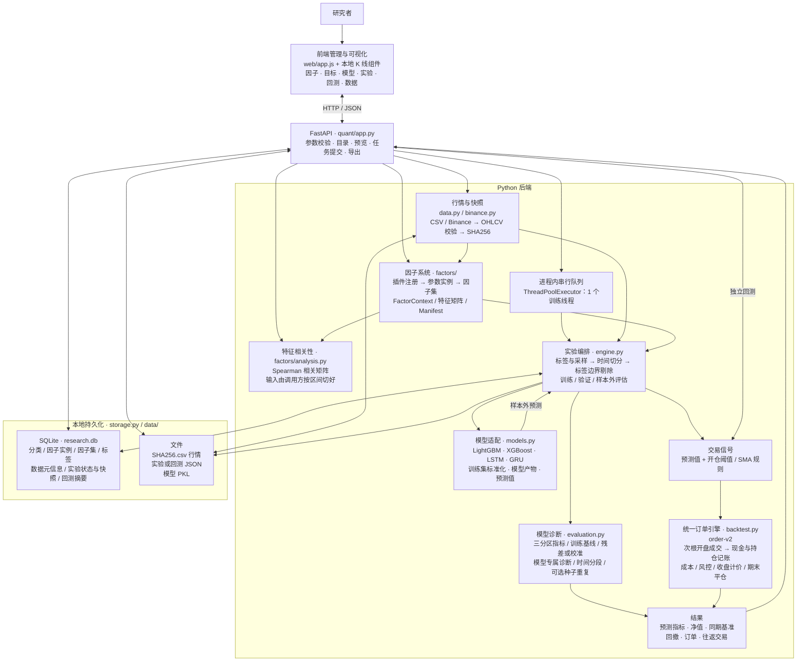
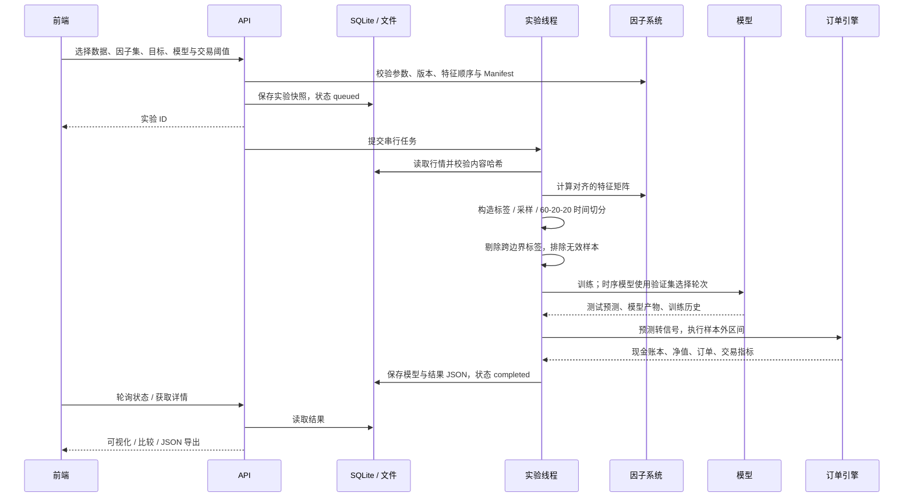

# 单标的量化研究平台架构

当前实现为本地模块化单体：FastAPI 提供 API 与静态页面，后台单线程执行训练任务；Python 负责全部因子、标签、模型和交易计算。图中实线均对应已有代码。

## 一次实验的执行顺序

## 核心对象及边界

| 对象 | 职责与约束 |
|---|---|
| Dataset | OHLCV 文件、时间范围、SHA256；每次读取验证实际文件内容 |
| FactorSpec | Python 算法声明：族、参数 schema、版本、scope、缺失策略、必需行情列 |
| FactorInstance | 具体参数与分类，保存在 SQLite；版本变化需重新创建 |
| FactorSet | 可复用的实例组合，绑定 Manifest 哈希 |
| FeatureManifest | 有序特征清单，记录实例、稳定标识、参数、版本、dtype、缺失策略 |
| Target | 回归收益或二分类标签；区间为下一根开盘至 h 根后开盘 |
| Experiment | 数据/因子/目标/模型配置快照、代码哈希、依赖版本、随机种子、状态 |
| ModelOutput | 回归：收益率；二分类：超过标签门槛的概率。预测值需经交易阈值转换 |
| Backtest | 统一执行语义、成本与风控；记录 `engine_version`，独立回测也记录代码哈希 |

前端只管理配置和展示结果。因子分类不决定计算方法：均线可使用向量化 `series` 插件，结构类可使用 `sample` 插件；最终都输出按行情索引对齐的一维数值序列，供模型组合使用。

`FactorContext` 公开接口只返回当前及历史数据的副本；私有字段不构成安全沙箱。`series` 插件能看到传入区间的完整 DataFrame，作者仍须避免未来函数，并为新增插件编写前缀截断一致性测试。框架不能自动证明任意 Python 算法不存在未来信息。

## 当前研究与成交约定

- 研究切分（60% 训练、20% 验证、20% 测试）统一由 `quant/splits.py` 定义，实验、事件采样与特征相关性共用同一口径。特征模块不感知切分：调用方先按区间切好行情，再交给它计算矩阵与相关性。单标的没有横截面，因此不计算 IC；择时能力由实验与回测判断。
- 标签预测跨度与持仓时间相互独立。收盘预测，下一根开盘成交，收盘估值；最后一个预测在下一根开盘执行后，于同根收盘清仓。
- 实验成本以手续费计入，滑点为零；独立回测继承实验成本，也可显式修改。相同信号、成本、仓位和风控参数下，两入口净值一致。
- 跳空先按开盘价格判断止损/止盈；盘中同时触及两条线且无更细路径时，保守地按止损先发生。实际价格路径不能由 OHLC 唯一确定。
- 基准在同一个可执行开盘全仓买入，并在同一期末清仓，使用相同成本。暴露比例统计发生持仓的 K 线占比，不表示精确盘中持仓时间。
- 历史 JSON 原样保留。旧实验没有 `order-v2` 标记，应重新运行后再与新结果比较。

## 后续扩展位置（尚未实现）

| 需求 | 建议接入位置 | 当前状态 |
|---|---|---|
| 缠论笔、线段、中枢与确认时点 | 新增结构计算层，再注入 `FactorContext.structure` | 仅有接口占位，当前为 None |
| 事件采样、滚动训练 | 从 `engine.py` 抽出采样器与切分器 | 当前逐 K 线采样、固定切分 |
| 自定义损失 | 给模型适配器增加 LossSpec 与兼容性校验 | 损失目前固定在模型实现中 |
| 强化学习奖励 | 新增交易环境、状态/动作及 RewardSpec | 当前是监督学习，无 RL 环境 |
| 模型加载与持续预测 | 新增统一 artifact 加载及预测服务 | 当前只生成训练产物 |
| 持久化任务和多进程部署 | 替换进程内队列，增加任务认领与锁 | 当前要求单服务进程，重启会将未完成任务标记失败 |

快照提供追溯信息，但未保存可独立重建的历史代码包与完整运行环境；长期复现还需版本控制和环境归档。
